# Shining Force III for PlayStation 5

Play **Shining Force III**, all three Scenarios and the Premium Disc, on a jailbroken PS5. This is a
homebrew port of [sfiii-native](https://github.com/damiantw/sfiii-native), a static recompilation of the
Sega Saturn game: it runs natively on the console with Vulkan graphics, the DualSense, save states,
fast-forward, 4:3 or 16:9, and the fan translation applied **on the console**.

**No game data is included.** You need your own disc images. The app builds each disc's game code
from your image the first time you start it, and can download and apply the English translation for you.

## Credits

- The Shining Force III translation project
  ([Shining Force Central](https://sf3transftp.shiningforcecentral.com/)): the English patch (V25) and its add-ons, which the app downloads and applies.
  None of its files are in this repo.
- [saturn-recomp](https://github.com/damiantw/saturn-recomp) and
  [sfiii-native](https://github.com/damiantw/sfiii-native): the Saturn recompiler and runtime this port runs on.
- [mihawk-99](https://github.com/mihawk-99): PS5_Vulkan, PS5_Mesa (RADV on the PS5) and PS5_PayloadSDK.
- [ps5-payload-dev/sdk](https://github.com/ps5-payload-dev/sdk) (John Törnblom).
- [Dear ImGui](https://github.com/ocornut/imgui), [miniz](https://github.com/richgel999/miniz) and the
  LZMA SDK (see [docs/third-party.md](docs/third-party.md)).

## Requirements

- A jailbroken PS5 running a homebrew environment (etaHEN or similar).
- [ShadowMountPlus](https://github.com/drakmor/ShadowMountPlus) or a similar tool that registers
  homebrew in `/data/homebrew/` as a title, so **PPSA93303** ("Shining Force III") appears on the home screen.
- Your own Shining Force III disc images (see [Your disc images](#your-disc-images)).

## Install

1. Get the `PPSA93303` folder: download `PPSA93303.zip` from the
   [Releases](https://github.com/damiantw/sfiii-ps5/releases) page and unzip it, or build it yourself
   ([Building the console title](#building-the-console-title)).
2. Copy it to a staging folder on the console first, e.g. `/data/sf3stage/PPSA93303`, with a file
   manager, a USB drive or FTP.
3. Move (rename) it to `/data/homebrew/PPSA93303`, so `eboot.bin` ends up at
   `/data/homebrew/PPSA93303/eboot.bin`. Moving it in one step keeps ShadowMountPlus from seeing a
   half-copied folder; if it does, it stops retrying the title until the console reboots.
4. Let ShadowMountPlus register it. "Shining Force III" appears on the home screen.

## Your disc images

Put your images in **`/data/shiningforceiii/`** (create it). Any layout works, up to 3 folders deep,
for example one folder per disc. Each image can be **BIN/CUE** (the `.cue` plus its `(Track 1)` and
`(Track 2)` `.bin` files) or a single **CHD**. The app finds them by content, not by name.

| Disc | Region and version | Serial | Redump | Data track (Track 1) SHA-1 |
|---|---|---|---|---|
| Scenario 1 | USA, V1.001 | MK-81383 | [20315](http://redump.org/disc/20315/) | `9b1033304091b3dea7c2fd6d88914a1c7d0c6727` |
| Scenario 2 | Japan, V1.003 (*Nerawareta Miko*) | GS-9188 | [20117](http://redump.org/disc/20117/) | `82c157dbad2f50bd8d1fd9b417233221ab9fd8c8` |
| Scenario 2 | Japan, Rev A, V2.000 | GS-9188 | [3508](http://redump.org/disc/3508/) | `e21f7ad51af3ef57af9f9f7db58afb2dd642e3ad` |
| Scenario 3 | Japan, V1.001 (*Hyouheki no Jashinguu*) | GS-9203 | [3507](http://redump.org/disc/3507/) | `6a2646030ff74a98b666726b78003e6505d24285` |
| Premium Disc | Japan, V1.000 | 6106979 | [28747](http://redump.org/disc/28747/) | `1b5de342984618965d25494f329cb317452b7a6e` |

You need at least one. Either Scenario 2 version works; you only need one of them.
The Japanese discs (Scenario 2, 3 and the Premium Disc) play in English once translated
([below](#translating-on-the-console)); an untranslated Japanese image shows "not a supported revision".
Images you already translated on a PC with the project's patcher (V25.1) are recognised too.
The European and Japanese releases of Scenario 1 are recognised but not supported: use the USA disc.

Check a dump on a PC with `sha1sum "… (Track 1).bin"`; the hash must match the table (the full SHA-256
of both tracks is in [src/disc/identify.cpp](src/disc/identify.cpp)). If a dump is not recognised,
the **Discs** page says why.

## Playing

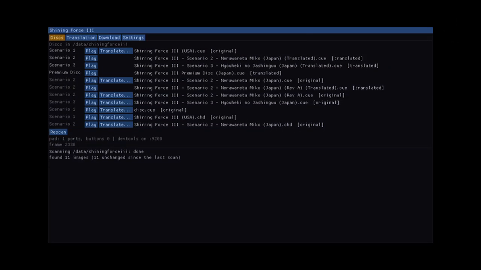

Start **Shining Force III** from the home screen. The **Discs** page lists every image found, with the
scenario and whether it is the original or translated; the list from the last scan appears straight
away and is refreshed in the background. Press **Play** next to a disc. The first time you start each
disc the app shows **Preparing** for a minute or two while it builds that disc's game code; it is kept in
`/data/shiningforceiii/cache/` and later launches start at once.

| Scenario 1 | Scenario 2 |
|---|---|
| 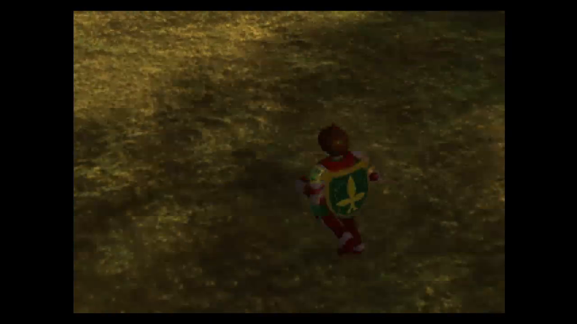 | 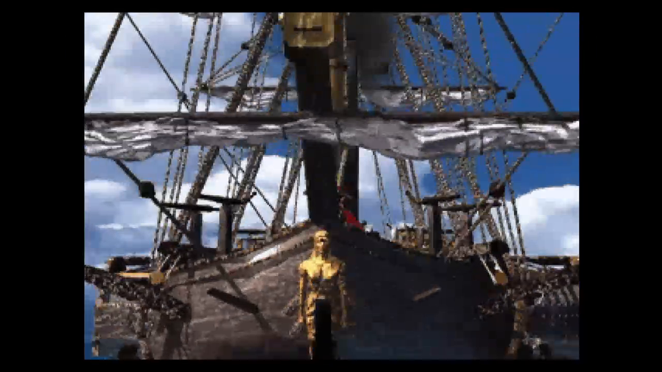 |
| **Scenario 2 (Rev A)** | **Scenario 3** |
| 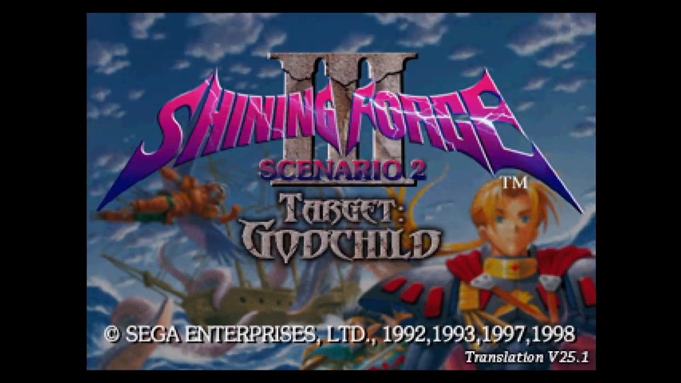 | 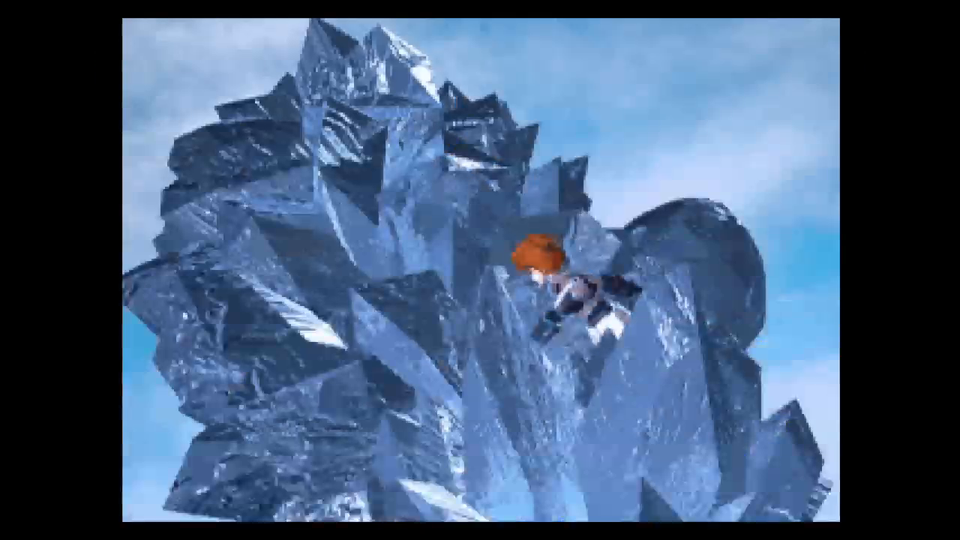 |
| **Premium Disc** | **Premium Disc menu** |
| 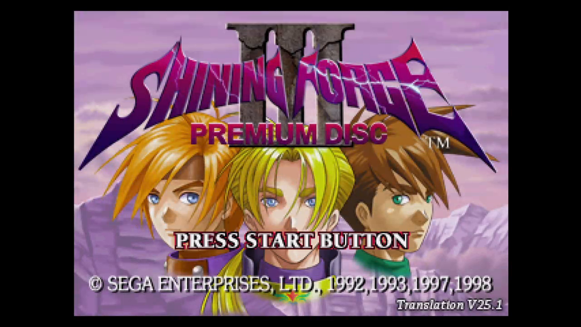 | 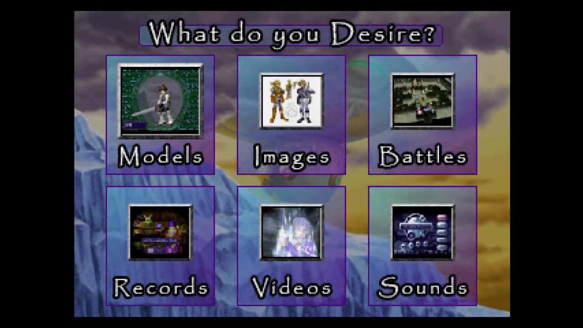 |

### Controls

The DualSense works as a Saturn pad: **Square** A, **Cross** B, **Circle** C, **Triangle** X, **L2** Y,
**R2** Z, **L1** L, **R1** R, **Options** START. Hold **R2** to fast-forward (Z then moves to R3).

The **touchpad** opens the in-game menu: save and load states (10 slots per disc), speed 1x/2x/3x,
4:3 or 16:9, and **Quit to launcher** to pick another disc. In menus, L1/R1 switch tabs, the d-pad moves,
Cross picks and Circle goes back. The game pauses while the menu is open.

The **PS button** works as usual. While the Control Center or the home screen covers the game, the
game pauses with the in-game menu open, so nothing runs unseen; resume from the menu when you come back.
To leave, close the game from the system (Control Center, or Options on the home-screen tile, then
**Close Game**). Your in-game saves are already on disk: the backup memory is written at every save the
game makes, so closing the app loses nothing that the game saved.

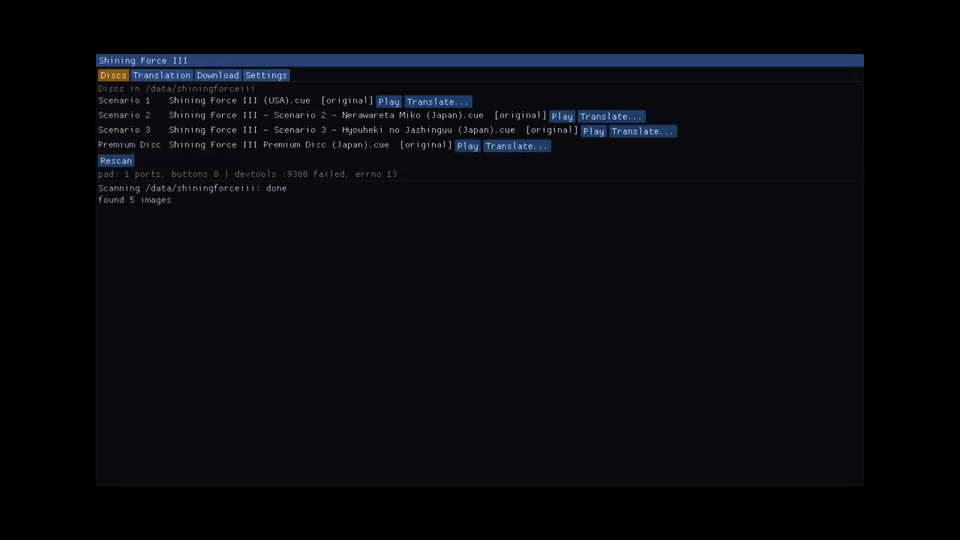

Saves made in the game itself go to one Saturn backup memory, `/data/shiningforceiii/saves/backup.bin`,
shared by all discs, so carrying your save from Scenario 1 into Scenarios 2 and 3 works as on the Saturn.

### 4:3 or 16:9

Pick 4:3 or 16:9 under Settings. In 16:9 the game world fills the wide screen: the extra
VDP2 columns come from `vdp2_compose_wide`, and the VDP1 sprites and polygons that reach the side
columns are drawn by a small CPU pass (`src/host/wide_sprites.h`) that matches the desktop GPU
renderer at 1x. Frame pacing is the same as 4:3 (16.7 ms average on the PS5).

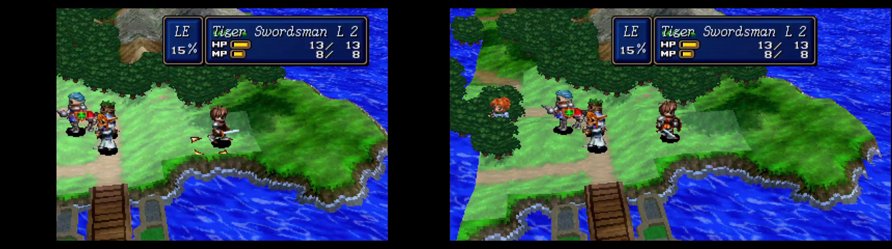

Movies and flat 2D screens stay 4:3 on purpose, on every platform. Known limits: the combat
backdrop sky is only 4:3 wide, and on some battle maps the game itself culls terrain outside the
4:3 view, so the edges show the floor or water plane there.

### Settings

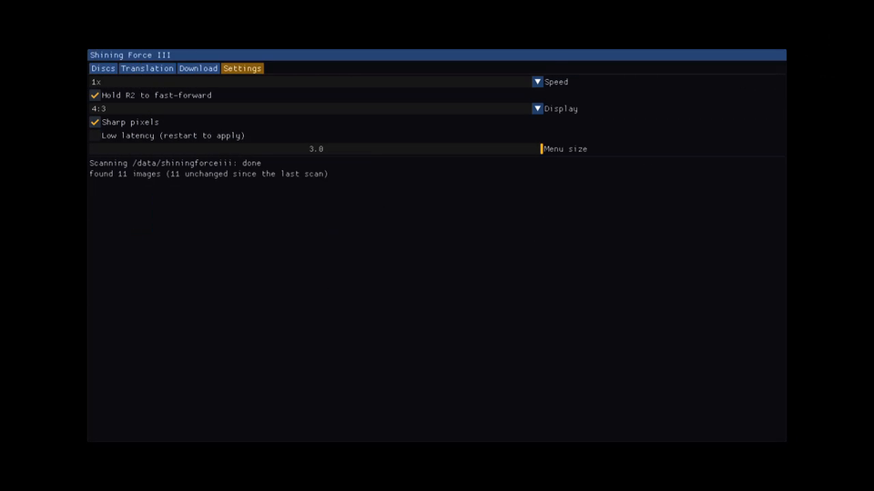

Speed, hold-to-fast-forward, 4:3/16:9, **3D resolution** (see below), sharp pixels (nearest-neighbour scaling), **low latency**
(two swapchain images instead of three, about one frame less delay; restart to apply) and the menu size.
They are saved in `/data/shiningforceiii/settings.txt`.

#### 3D resolution

Draws the 3D (VDP1 polygons and sprites) at a multiple of the Saturn's resolution on the PS5 GPU, using
sfiii-native's geometry shader (as the desktop app does), then scales the picture to the TV.
Options: **1x (original, the default)**, 2x, 3x, 4x and 6x (`render_scale=` 1-6 in settings.txt).

| Setting | Internal picture, 4:3 (320x240 field) | 16:9 (about 427x240) |
|---|---|---|
| 1x | 320x240 (software, as before) | 427x240 |
| 2x | 640x480 | 854x480 |
| 3x | 960x720 | 1281x720 |
| 4x | 1280x960 | 1708x960 |
| 6x | 1920x1440 | 2562x1440 |

On a PS5 every setting held 60 fps in battle and field scenes, in both 4:3 and 16:9. The GPU pass takes
about 2-4 ms whatever the scale, packing the scene takes about 1 ms of CPU, and the targets use 3 MiB at 2x
up to 32 MiB at 6x.

Known limits:
- Some battle-map polygon edges show a few dots of the background (blue) at any setting above 1x;
  higher settings make them thinner, not fewer.
- 2D layers (VDP2 backgrounds, text and menus) stay at the native resolution.
- In 16:9 the game still culls terrain outside its 4:3 view, so the edges can show the floor or water plane.

## Translating on the console

Scenario 2, Scenario 3 and the Premium Disc were only released in Japanese. The app can apply the
fan translation to your images itself:

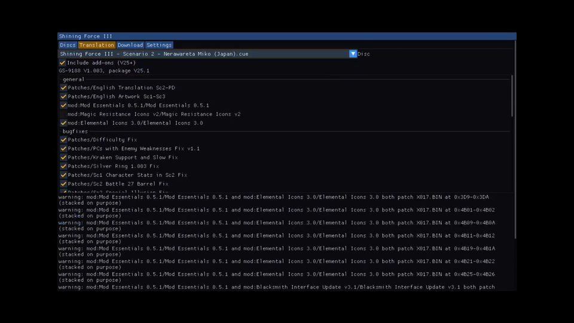

1. **Get the patch.** On the **Download** page, tick **Allow downloading** and press **Download**. The app
   fetches the translation project's **latest version** from sf3transftp.shiningforcecentral.com (`SF3Patch.exe`, which holds the patch data) and
   the optional **add-ons** (V25+) over HTTPS into `/data/shiningforceiii/translation/`. Nothing is
   downloaded unless you do this. If your network blocks it, copy `SF3Patch.exe` to
   `/data/shiningforceiii/translation/` and the add-on zips to `translation/V25+/` yourself.
2. **Choose a disc** on the **Translation** page (or press **Translate…** next to it on the Discs page).
3. **Pick patches.** The list matches the project's Windows patcher: the translation itself, the English
   artwork and the bug fixes are ticked by default, and **Include add-ons** adds the optional V25+
   patches (music fixes, Mod Essentials and so on). Untick anything you don't want.
4. **Choose where it goes:**
   - **New image** (default): writes `<name> (Translated).bin/.cue` beside the original, which stays
     untouched. Needs as much free space as the disc.
   - **Replace the original** (BIN/CUE only, asks first): patches the image in place and keeps the
     original files as `.bak`; delete those once the translated disc plays.
5. Press **Patch**. The Discs page then lists the translated image, and **Play** uses it in place of the
   original.

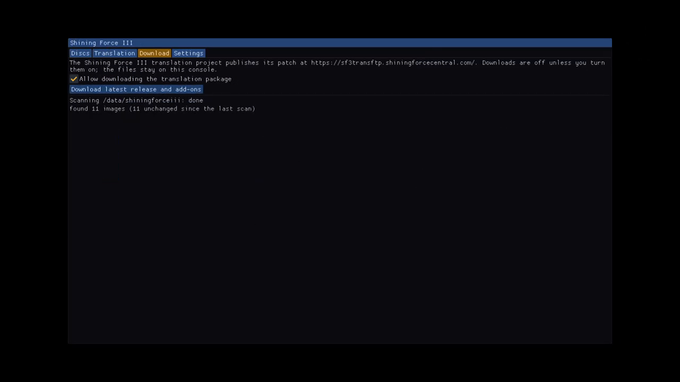

## Data folder

Everything that belongs to you lives in `/data/shiningforceiii/`, outside the app folder, so updating
or reinstalling the app never touches it:

```
/data/shiningforceiii/
  <your disc images>       BIN/CUE or CHD, any layout
  translation/             SF3Patch.exe and V25+/ add-ons (downloaded or copied)
  saves/                   in-game saves (backup.bin, shared by all discs)
  states/                  save states, 10 slots per disc
  settings.txt             settings
  cache/                   game code built from your discs (safe to delete; rebuilt on the next start)
  logs/
```

Back up `saves/` and `states/` to keep your progress.

## Known issues

- The first start of each disc takes a minute or two (**Preparing**); later starts are quick.
- Switching discs restarts the app, so the screen goes black for a moment.

## License

MIT (see [LICENSE](LICENSE)). Third-party code is MIT/BSD-compatible; there is no GPL/LGPL code, and no
game data, translation files or BIOS are included.

---

# For developers

This repo holds the PS5-only parts: packaging and the title ID (PPSA93303), the Vulkan renderer backend,
the on-console disc patcher and menu, and dev tools. The recompiler port and the SH-2 interpreter fallback
live in [sfiii-native](https://github.com/damiantw/sfiii-native), the submodule at `external/sfiii-native`.
Code layout: `src/disc` (BIN/CUE and CHD reading, identification, scanning), `src/patch` (a C++ port of
sfiii-native's `tools/sf3patch`, byte-identical to the Python patcher), `src/menu` (Dear ImGui launcher and
overlay), `src/host` ([docs/host.md](docs/host.md)), `src/runtime`, the debug server
([docs/devtools.md](docs/devtools.md)) and the MIT title platform ([docs/platform.md](docs/platform.md)).

## Building the console title

`tools/ps5/build-title.sh` builds the app as a homebrew folder title,
`build/ps5-title/PPSA93303/` (title ID: `docs/title-id.md`). It contains `eboot.bin`,
`sce_module/libc.prx`, `sce_sys/param.json` and `profiles/`, which holds sfiii-native's revision
profiles, read at `/app0/profiles`. It is sfiii-native's generic build, so it has no code or data
made from a disc: each disc's game code is built on the console at its first launch (see
[First launch of a disc](#first-launch-of-a-disc)). It needs the same tools as the test title
below, plus `SATURN_RUNTIME` (saturn-recomp's `runtime/` with sfiii-native's
`tools/runtime-diagnostics.patch`). `VULKAN_INCLUDE` must hold Vulkan-Headers 1.4.354 or newer and
nothing else (not `/usr/include`, which puts the host libc ahead of libc++). `TITLE_ID=` and `OUT=`
override the defaults. The build also copies the home-screen art from `ps5/sce_sys/` (`icon0.png` 512x512,
`pic0.png`/`pic1.png` 1920x1080), made from the US title screen as rendered by the port, with the
sides widened to 16:9 and the copyright line removed.

A release build leaves the debug server out (`SF3_PS5_DEVTOOLS=OFF`, the default) and keeps the
16:9 timing line out of `stderr.txt`. `tools/ps5/package-release.sh` (with the same `OUT=`) turns the
folder into `dist/PPSA93303.zip` plus `dist/SHA256SUMS`, the files on the Releases page, and refuses a dev
build. It is a ZIP of the folder, not a signed `.pkg`: homebrew titles install as a folder.

To install, copy the folder to a staging path such as `/data/sf3stage/` first, then rename it into
`/data/homebrew/` so ShadowMountPlus sees it complete. If it finds the folder half-copied or without
`icon0.png`, it stops retrying that title ID until the console reboots.

Both `eboot.bin` and `sce_module/libc.prx` are wrapped as fake SELFs by `tools/ps5/make-fself.py`
(MIT, written from the container layout); the module uses the PS5 module magic `54 14 F5 EE`.
`tools/ps5/prx-fixup.py` turns the converter's output for the companion into a module (ELF type,
module param, SONAME, module info and its export library). The build output is byte-for-byte
reproducible.

The loader's libSceLibcInternal looks up the companion's exports, so `tools/ps5/companion-exports.py`
gives it the 2566 NIDs listed in `tools/ps5/libc-exports.tsv` (libraries `libc` and `libc_setjmp`;
names, sizes and kinds only). The converter cannot publish exports, so the tool adds them to the
converted module and the build fails unless the list matches exactly. setjmp/longjmp, atexit,
`__cxa_finalize`, `_malloc_init` and `Need_sceLibc` are real; every other function stores its table
row in `sf3_last_row` and returns 0. The dynlib data is rebuilt in the layout system modules use, and
the thread-local exports sit in the RELRO segment. `SF3_COMPANION_EXPORTS=none|notls|full` (default
full) selects a variant for bisecting.

Two things were required for the companion to load: the module's DT_INIT must return 0 (a bare `ret` left eax set and libSceLibcInternal
rejected the module with `PRX_SCE_MODULE_LOAD_ERROR`), and the needed-module entries carry version
1.1 with export library ids following the import libraries, as system modules do. The companion no
longer imports libSceLibcInternal.

## Console test title (swapchain)

`tools/ps5/build-test-title.sh` builds a 10-second 4K swapchain test as a
homebrew folder title (`build/ps5-test/PPSA99331/`). It uses only this repo's
MIT platform layer; see [docs/platform.md](docs/platform.md) for what each
piece replaces and how it was written. It needs `VULKAN_INCLUDE`,
`PS5_PAYLOAD_SDK` (compiler and system stubs only), `RADV_ARCHIVE` and
`PS5_NATIVE_TOOL`. Copy the folder to `/data/homebrew/` and launch it. The test
writes `/data/sfiii-ps5-test/swapchain.txt` (create that folder first).
Status: the startup code, platform shim and linker script pass on the console
(3840x2160, 60 fps). The title crashes on exit.

## Build (Linux: tools and tests)
```sh
git clone --recursive https://github.com/damiantw/sfiii-ps5
cmake -S . -B build -DSF3_PS5_DEVTOOLS=ON && cmake --build build
tools/devtools/test_sf3dev.py build/test_debug_server
```
Release builds leave `SF3_PS5_DEVTOOLS` OFF.

PC tools (the same code the console runs):
```sh
build/sf3disc scan /path/to/discs                 # which disc fills which slot
build/sf3disc identify disc.cue|disc.chd
build/sf3disc probe disc.cue [EXTRACT_DIR [PROFILES_DIR]]  # content manifest + ID (as sfiii-native tools/probe.py), root .BIN files, matching profile
build/sf3prepare disc.cue DATA_DIR PROFILES_DIR      # the first-launch step: module set in DATA_DIR/cache/
build/sf3patch fetch --dest translation           # opt-in download (curl): SF3Patch.exe + V25+ add-ons
build/sf3patch list  disc.cue --package translation/SF3Patch.exe --addons translation/V25+
build/sf3patch patch disc.chd --package translation/SF3Patch.exe --addons translation/V25+ -o out.bin
build/sf3patch patch disc.cue --package ... --in-place     # replaces the BIN/CUE; originals kept as .bak
```
`--enable/--disable/--only NAME` change which patches are ticked. `--reproducible` gives fixed
timestamps; that is how the tests compare against the Python patcher.

CI (`.github/workflows/ci.yml`) builds everything and runs the tests that need no game data: the
debug server test, `patch_quirks` against the Python patcher, `runtime_host_test` (the menu's runtime glue on a fake runtime), `fetch_sce_test` (the console's download transport on a fake sceHttp), a compile of
`src/runtime/runtime_bind.cpp` against the pinned saturn-recomp with sfiii-native's patch,
`tests/sevenzip_test.sh` (synthetic files packed
five ways with the 7-Zip CLI), `vk_scene_test`, `vk_menu_test`, `host_test` (the PS5 host: pacer,
pad layout, a sine's pitch through the 48 kHz path on SDL's disk driver, the menu over synthetic
fields, relaunch through execv), a compile of `src/host/host_runtime.cpp` against the runtime
(Mesa's lavapipe software Vulkan, SDL2 virtual controller), and the disc-data and release checks.

The Vulkan tests and the menu's gamepad code need the Vulkan headers/loader and SDL2 on PC
(Debian/Ubuntu: `libvulkan-dev mesa-vulkan-drivers libsdl2-dev`); without them those targets are
skipped. `build/vk_menu_test [shot.ppm]` draws the menu over a test picture, drives it with a
virtual pad, and can save the frame.

Tests, which need your own discs and the translation package on the machine; neither is committed:
`tests/sf3patch_vs_python.sh` (byte-identical to the Python patcher), `build/patch_quirks` with
`tests/patch_quirks.py`, and `tests/menu_smoke.sh`. The last one drives the real menu headlessly
through ImGui's null backend and checks both patch modes against the reference image.

## License
MIT (see LICENSE). Third-party code must be MIT/BSD-compatible. There is no GPL/LGPL code.

### PS5: reading /data

A PS5 title may not use libc `opendir`/`realpath`/`getcwd` (EPERM). The disc scan lists directories with `open(O_DIRECTORY)` + `getdents`, and MIT shims give `getcwd` = `/app0` and a lexical `realpath`. Put discs under `/data/shiningforceiii/` (any subfolder layout); launch the title from the home screen.

### PS5: title runtime notes

- `fstatat`/`openat`/`unlinkat`/`fdopendir` exist only in libkernel_sys, which a title cannot import; left unresolved they became calls through NULL (the crash on starting any disc). MIT shims (`ps5/platform/title/path_shims.c`, `dir_shims.c`) cover them, and first-launch prepare removes folders with its own getdents walk.
- The C heap (`ps5/platform/title/heap.c`, linked with `--wrap=malloc` etc.) comes from direct memory; the system malloc refused tens-of-MB blocks. Disc files are hashed and extracted in chunks.
- A fault handler (`fault_klog.c`) writes signal, registers and stack to the kernel log.
- Profiler: `/data/sfiii/sample.enable` turns on a sampler in `fault_klog.c`. Any content logs the
  main thread's rip every 500 ms; `perf` takes 1 kHz samples instead and sorts them into
  x64 (the module set the loader mapped), eboot, other (system libraries) and wait (present/pace),
  plus frame time and work time per frame. Every 7 s it writes `[sf3 perf]` lines to klog: totals,
  a frame-time histogram, present time and each frame over 25 ms split into work / acquire / draw /
  queue. `perf frames` skips the sampling (frame times only); `perf file` also appends to
  `/data/sfiii/perf.txt`. Any frame over 50 ms prints a `hitch:` line to stderr.
- Frame pacing: the FIFO swapchain (3 images) paces the machine at the TV's 60 Hz (`Pacer::follow`);
  the audio resampler nudges its rate by up to 0.5% to keep its queue near 90 ms, so nothing is
  dropped. `/data/sfiii/pace-timer` brings back the Saturn-clock timer, `/data/sfiii/swap2` two images.
- stderr: the system libc's stderr took 40-100 ms a write on the console, and RADV logs a line from its
  submit path every 10 s, a 100 ms hitch each time. `stderr_fast.c` (`--wrap=fprintf` etc.) formats
  stderr text itself and writes it to a pipe that a thread drains into `/data/sfiii/stderr.txt`.
- A `.chd` given to the runtime (`launch=` or the menu) is unpacked once to
  `/data/shiningforceiii/cache/chd-<disc id>/` and played from there.
- 4:3 leaves out the frame's first column, which on many screens holds the VDP2 back-screen colour
  (a blue stripe a CRT hides in overscan).
- The dev-build debug server listens on port 9200 by default: a title's bind on 9300/9301 fails with EACCES.
- Japanese Scenario 2/3 and Premium Disc images must be translated (v25.1 patch, Translate page) before they play; untranslated images report "not a supported revision".

### PS5: controllers

The launcher reads every logged-in user's controller, so a Remote Play pad drives the menu too. It does not open the remote-control port: a title holding that port takes the PS button away from the system. The launcher's last line shows the pad state. Dev builds can also be driven without a pad (docs/devtools.md: `launch=` in /data/sfiii/devtools.enable).

- Disc switch / quit to launcher relaunches via `sceSystemServiceLoadExec("/app0/eboot.bin")`; a running title cannot `LaunchApp` itself (0x8094000F).
- JIT unwind info is registered per FDE (`__register_frame(fde)`); the SDK libunwind rejects a CIE pointer.
- Stale `cache/work-*` folders are swept at prepare time.
